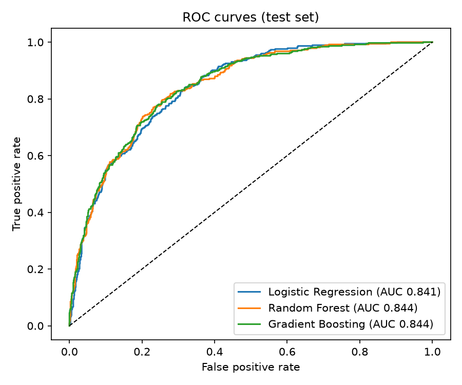
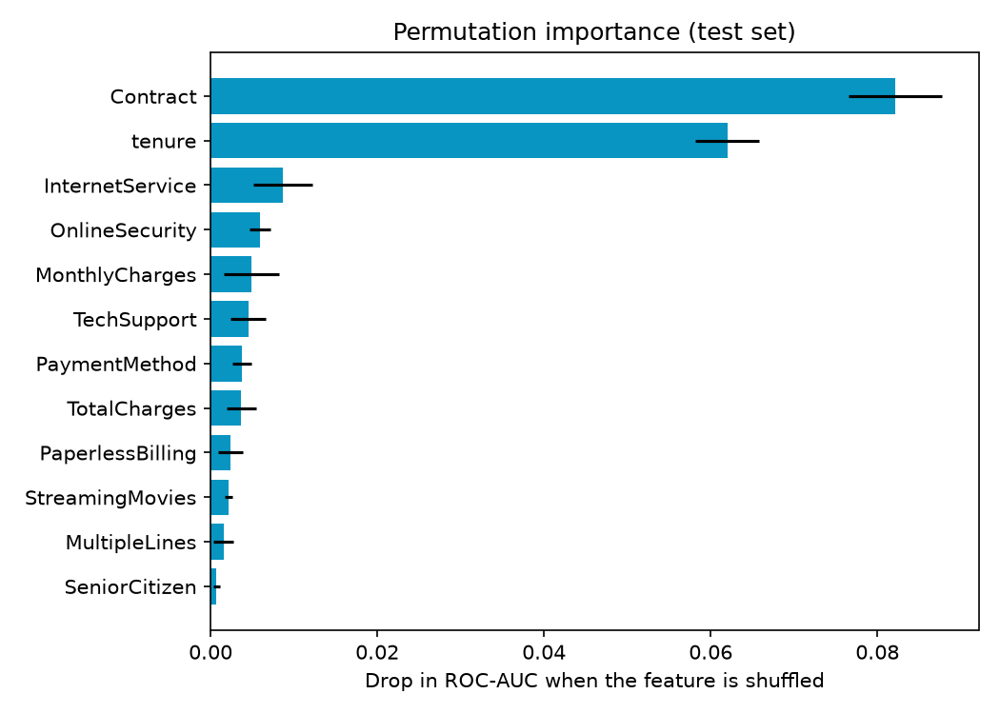

# Results

Dataset: `telco_churn.csv`, 7,043 customers, churn rate 26.5%. Stratified split: 5,634 train / 1,409 test (test set untouched until final evaluation).

## Model comparison (test set; `cv_roc_auc` is 5-fold CV on the training split)

| model | cv_roc_auc | roc_auc | pr_auc | precision | recall | f1 | threshold |
|---|---|---|---|---|---|---|---|
| Logistic Regression | 0.846 | 0.841 | 0.627 | 0.538 | 0.73 | 0.62 | 0.575 |
| Random Forest | 0.848 | 0.844 | 0.653 | 0.545 | 0.762 | 0.635 | 0.518 |
| Gradient Boosting | 0.848 | 0.844 | 0.661 | 0.547 | 0.733 | 0.626 | 0.575 |

## Selected model: Gradient Boosting

| Metric | Tuned threshold (0.5748) | Default 0.5 |
|---|---|---|
| ROC-AUC | 0.844 | 0.844 |
| PR-AUC | 0.661 | 0.661 |
| Precision | 0.547 | 0.510 |
| Recall | 0.733 | 0.802 |
| F1 | 0.626 | 0.624 |
| Accuracy | 0.768 | 0.743 |

Top 20% highest-risk customers contain **50.8%** of all churners (lift 2.5x vs. random targeting).

## Top drivers (permutation importance, drop in ROC-AUC)

1. Contract (0.0822)
2. tenure (0.0620)
3. InternetService (0.0087)
4. OnlineSecurity (0.0060)
5. MonthlyCharges (0.0049)
6. TechSupport (0.0045)
7. PaymentMethod (0.0038)
8. TotalCharges (0.0036)

 
